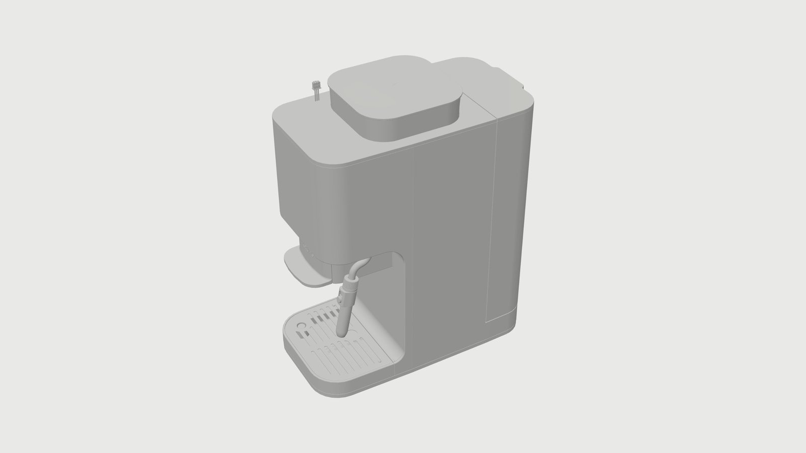
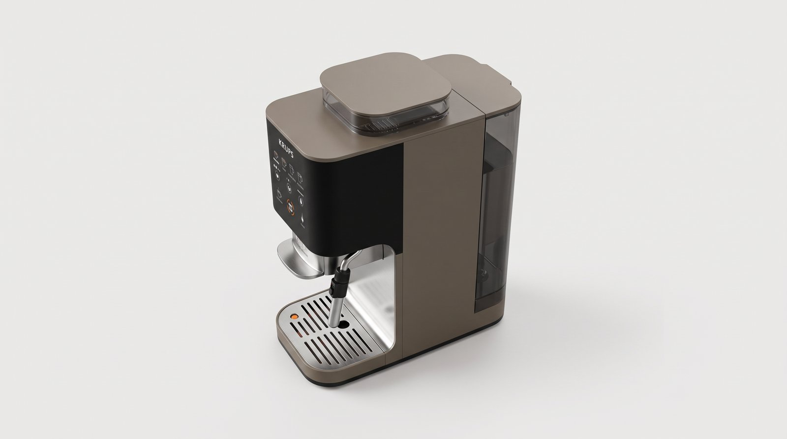
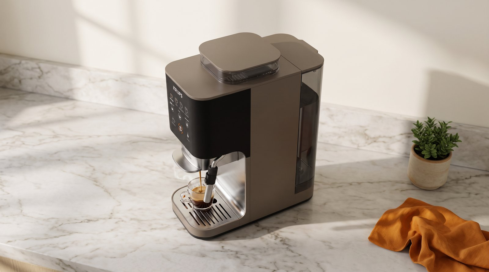
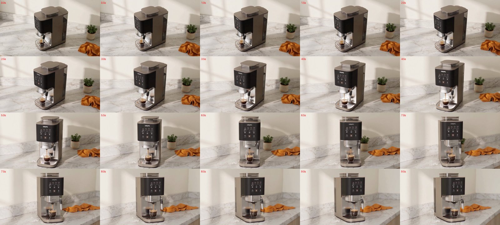

# render-to-product-video

A Claude skill that turns a **grey 3D product render** into a **product video**: it re-skins the render with the real materials from product photos, places the product in a scene described by the user, then animates it with a camera move copied from a reference video.

The product geometry comes from the render at every step and is never regenerated. Each step is checked before the next one starts, and the start frame must be approved before any video credits are spent. Before the first generation Claude checks that your balance covers the whole job, video included, and stops if it does not.

## Why

Asking a video model to "show this product" redraws the product: proportions drift and details change between frames. This skill splits the job into three controlled generations:

1. **Re-skin** on the render's plain background, so the geometry stays locked to the render.
2. **Start frame**: the same image with only the environment and light changed.
3. **Video**: the start frame as the exact first frame, a reference clip for the camera path only, and the product photos to keep unseen sides consistent.

Changing materials and scene in a single edit shifts the perspective; doing them one at a time does not.

## How it works

```
grey render ──► pad ──► re-skin ──► check ──► start frame in scene ──► approval ──► video ──► inspection
                          ▲                        ▲                                  ▲
product photos ──► materials list           scene + light                 reference camera move
                                                                     (read every 0.5 s)
```

| Step | What happens | Where |
|---|---|---|
| 0. Inputs | Render, product photos, reference video, optional environment photos; finds usable connectors | chat |
| 1. Settings | Image model, video model, aspect ratio, duration and resolution; then balance and total cost, before anything is generated | form + connector |
| 2. Scene | Environment, concrete light, scene content, audio | form |
| 3. Materials | Claude lists material and colour of each part; the user confirms or corrects | form |
| 4. Canvas | Render padded (never cropped) to the target ratio | local script |
| 5. Re-skin | Editing model on a plain background, checked with a 50% overlay | connector + local script |
| 6. Start frame | Environment and light added, product untouched; user approval | connector + form |
| 7. Camera reference | Reference video read every 0.5 s and described interval by interval | local script |
| 8. Video | Video model with start frame, product photos and motion reference | connector |
| 9. Inspection | Contact sheet of the result; accept, regenerate or fix | local script + form |

Every choice is asked through multiple-choice forms; Claude talks to the user in their own language.

## Requirements

- **Claude** with skills enabled (claude.ai, Claude desktop app, or Claude Code).
- **A generative-AI connector** (MCP), for example fal, Magnific, Replicate or a Google Gemini connector, offering:
  - a multi-image **editing model**: **Nano Banana 2.1** recommended, then **Nano Banana 2**;
  - a **video model** that takes a start image plus a motion-reference video: **Seedance 2.5 reference-to-video** recommended.

  If either is missing, the skill suggests a connector. The video step is by far the most expensive: see [Connectors and credits](#connectors-and-credits).
- **Python 3** with `numpy` and `Pillow`, and **ffmpeg**, in the environment where Claude runs code. The scripts cost no credits.

## Installation

### claude.ai / Claude desktop app

1. Download `render-to-product-video.zip` from the [latest release](../../releases/latest).
2. In Claude's settings, open the **Skills** section and upload the zip.
3. Make sure code execution and file creation are enabled.

### Claude Code

```bash
git clone https://github.com/Bagareal/myskills.git
mkdir -p ~/.claude/skills
cp -r myskills/render-to-product-video ~/.claude/skills/
```

For a single project, copy it into `.claude/skills/` inside that project instead.

## Usage

Invoke it by name or describe the task:

```
/render-to-product-video
```

```
Make a product video from this render: kitchen counter in the morning, same camera move as this clip.
```

Then attach:

1. **The grey render** on a plain, uniform background.
2. **Real photos of the product.** More angles give better results, especially for the sides the camera reveals during the move.
3. **The camera reference video**: any clip whose camera path you want to copy (an orbit, a push-in, a crane). Its look, background and framing are ignored.
4. **Optional environment photos** for the scene.

## Settings

| Setting | Options | Default |
|---|---|---|
| Image model | Every available editing model | Nano Banana 2.1 |
| Video model | Every available start-image + motion-reference model | Seedance 2.5 reference-to-video |
| Aspect ratio | 16:9, 9:16 | 16:9 |
| Duration and resolution | Match the reference at 1080p or 720p, or typed | Match the reference, 1080p |
| Environment | Described by the user or from attached photos | - |
| Light | Concrete setups proposed for the scene, or typed | - |
| Scene content | Product only, or typed (a cup, steam, props) | Product only |
| Audio | Off, On | Off |

**Vertical (9:16) with a 16:9 reference:** the camera path is copied, but the framing may change and the product can look narrower or get cropped. A vertical reference avoids this.

**Duration:** the video matches the reference's length. Do not speed the reference up to shorten the video: the first frame drifts away from the approved start frame.

## Connectors and credits

The steps and the scripts are the same on every connector; only the names of the generation parameters change. The skill was built on fal. On Magnific the same run wasted credits: model and aspect ratio were left on `auto`, the re-skin came back mirrored and enlarged, Claude tried crop and paste back, replace background, outpaint and 4K to rescue it, and the credits ran out before the video. The skill now follows these rules everywhere:

- **Cost first.** Right after the settings form Claude reads the balance and prices the video with the chosen model, duration and resolution, then the two image steps. If the balance does not cover the video plus one retry of each image step, it says so, offers what fits (lower resolution, shorter duration, another model or connector) and generates nothing.
- **Nothing on `auto`.** Model, aspect ratio and resolution are always set explicitly.
- **Only the skill's steps.** No extra tools to rescue a failed step.
- **Stop after two failures.** If a step fails its check twice, Claude stops, shows what went wrong and asks, giving the cost of each option.
- **Cost before each call.** One line with the price before every paid generation.

### Parameters per connector

| | fal | Magnific |
|---|---|---|
| Image model | `google/nano-banana-2.1/edit` or `fal-ai/nano-banana-2/edit` | `images_generate` with `mode: imagen-nano-banana-2-flash` (Nano Banana 2; `imagen-nano-banana-2` is Nano Banana Pro) |
| Image inputs | `image_urls`: canvas first, then photos | `references` of type `image`: canvas first, then photos |
| Image settings | `aspect_ratio` explicit, `resolution` `2K`, `thinking_level` `high` | `aspectRatio` explicit, `resolution` `2k` |
| Video model | Seedance 2.5 reference-to-video, task `reference` | `video_generate` with `slug: bytedance-seedance-pro-2.5` |
| Video inputs | `image_urls` (start frame first, then photos), `video_urls` | start frame as the first `image` reference (`@Image1`), photos as further `image` references, the camera reference as a `video` reference. On Magnific `keyframes.start` cannot be combined with references, so it is not used. |
| Audio | `generate_audio` false | `withSoundEffects` false |
| Cost tools | `estimate_cost` | `account_balance`, then `simulate_cost` |

### Prices seen on Magnific (November 2026, indicative)

| Generation | Credits |
|---|---|
| Image edit at 2K | about 65-75 |
| Image edit at 4K | about 150 |
| Seedance 2.5, 10 s, 1080p | 5400 or more |
| Seedance 2.5, 5 s, 720p | 1300 or more |
| Seedance 2.5 Flash, 10 s, 720p | 1700 or more |

The video quotes from `simulate_cost` leave out the seconds of the reference video, which are billed too, so the real price is higher. On a Premium plan (20,000 credits a month, no extra credit packs) a single 10 s 1080p video takes more than a quarter of the month.

Full parameter tables and model limits: [docs/models.md](docs/models.md).

## Scripts

All scripts are in [`scripts/`](scripts) and can also be used on their own.

### `pad_to_ratio.py`

Pads an image to a target aspect ratio, centring it on a canvas filled with its own background colour. It never crops.

```bash
python3 -I scripts/pad_to_ratio.py render.png render_pad.png 16:9
```

### `compare.py`

Compares a generated image with its reference.

```bash
python3 -I scripts/compare.py render_pad.png reskin.png side.png blend.png
```

Prints the silhouette IoU and both bounding boxes, and writes a side-by-side image and a 50% overlay.

- **IoU** (1.0 = identical silhouettes) is a signal, not the verdict: a soft shadow lowers it even when the product is correct. On a scene or a dark background it is meaningless.
- **The overlay is the verdict.** Contours, seams and proportions must line up with no double edges.

### `contact_sheet.py`

Extracts frames at a given rate and tiles them four per row, each labelled with its time.

```bash
python3 -I scripts/contact_sheet.py reference.mp4 reference_sheet.png 2
```

Used twice: to read the reference camera move before writing the prompt (a move described from the first and last frame alone is usually wrong), and to inspect every half second of the generated video.

## Limits and known failure modes

| Problem | Cause | Fix |
|---|---|---|
| Product deforms | General image model | Editing model on the render |
| Perspective shifts | Materials and scene changed in one edit | Re-skin first on plain background, then the scene |
| Orbit stops early | Move described from first and last frame | Read the reference every 0.5 s |
| First frame drifts | Reference sped up | Use the original reference and a matching duration |
| Grey look or plain background in the video | Reference style leaks | Prompt states the reference is camera motion only |
| Random reflections, light streaks | Vague light description | Light attached to the product, slow, with direction and fall-off |
| Stray transparent objects, tiny coloured lights, lighter front at the end | Video model artefacts | Spotted on the contact sheet; regenerate |
| Unreadable panel text | 720p | Use 1080p |
| Re-skin mirrored or enlarged on Magnific | Model and aspect ratio left on `auto` | Nano Banana 2 and the ratio set explicitly |
| Credits gone before the video | Images and rescue attempts first, video never priced | Price the video before the first generation; stop after two failures |

Seedance 2.5 reference limits (check the schema of the model you use): 1.8-30.2 s, 300-6000 px per side, aspect ratio 0.4-2.5, 24-60 fps, up to 200 MB.

## Documentation

| File | Contents |
|---|---|
| [`docs/workflow.md`](docs/workflow.md) | The pipeline step by step, with the reasoning behind each step |
| [`docs/prompts.md`](docs/prompts.md) | Prompt templates for re-skin, start frame and video, with placeholders |
| [`docs/verification.md`](docs/verification.md) | How to read the checks: IoU, overlay, contact sheet |
| [`docs/models.md`](docs/models.md) | Model roles, parameters per connector, limits, how to swap models |
| [`docs/troubleshooting.md`](docs/troubleshooting.md) | Every failure seen so far, with cause and fix |
| [`examples/kitchen-orbit/`](examples/kitchen-orbit/README.md) | A complete worked example with screenshots, checks and the output video |

## Example

Grey render, re-skin and start frame from the worked example, then the output video one frame every 0.5 s. The full walkthrough, with the overlay checks and the camera reference, is in [`examples/kitchen-orbit`](examples/kitchen-orbit/README.md).

| Grey render | Re-skin | Start frame |
|---|---|---|
|  |  |  |



> **For illustration only.** The example shows a commercial coffee machine. Brands, logos and designs belong to their owners; this project is not affiliated with them. See [DISCLAIMER.md](DISCLAIMER.md).

## License

[MIT](../LICENSE). The example media are not covered by the license: see [DISCLAIMER.md](DISCLAIMER.md).
